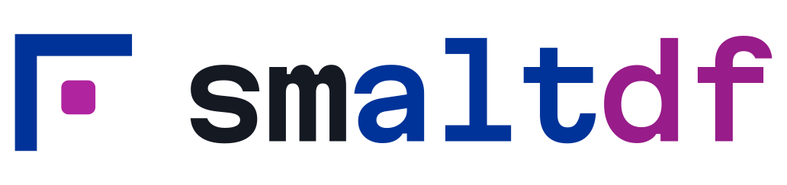
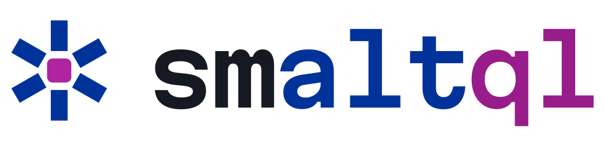
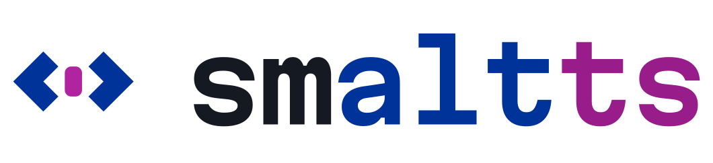

<h1>
  <picture>
    <source media="(prefers-color-scheme: dark)" srcset="logos/smaltdb/lockup-on-dark.svg">
    
  </picture>
</h1>

**Small. Alternative. Fast.**

Brand assets and design tokens for smaltworks and the smalt projects: [smaltdb](https://github.com/stenhoor/smaltdb), a fast alternative database for the browser, written in TypeScript; [smaltui](https://github.com/stenhoor/smaltui), a SQL console for smaltdb that runs entirely in the browser; [smaltbi](https://github.com/stenhoor/smaltbi), business intelligence in the browser, powered by smaltdb; [smaltdf](https://github.com/stenhoor/smaltdf), dataframes for smaltdb, small and fast; [smaltnb](https://github.com/stenhoor/smaltnb), TypeScript notebooks for smaltdb; [smaltql](https://github.com/stenhoor/smaltql), the SQL you know, for smaltdb; and smaltts, smaltdb, straight from TypeScript. Docs: [smaltdb.dev](https://smaltdb.dev).

<p>
  <picture><source media="(prefers-color-scheme: dark)" srcset="logos/smaltui/lockup-on-dark.svg"></picture>
  &nbsp;&nbsp;
  <picture><source media="(prefers-color-scheme: dark)" srcset="logos/smaltbi/lockup-on-dark.svg"></picture>
  &nbsp;&nbsp;
  <picture><source media="(prefers-color-scheme: dark)" srcset="logos/smaltdf/lockup-on-dark.svg"></picture>
  &nbsp;&nbsp;
  <picture><source media="(prefers-color-scheme: dark)" srcset="logos/smaltnb/lockup-on-dark.svg"></picture>
  &nbsp;&nbsp;
  <picture><source media="(prefers-color-scheme: dark)" srcset="logos/smaltql/lockup-on-dark.svg"></picture>
  &nbsp;&nbsp;
  <picture><source media="(prefers-color-scheme: dark)" srcset="logos/smaltts/lockup-on-dark.svg"></picture>
</p>

## What's here

| Path | Contents |
| --- | --- |
| [`site/`](site/) | The smaltworks.dev website: the family, the architecture, why smalty, status, community and the brand kit. VitePress, built and deployed by `.github/workflows/site.yml`. |
| [`BRAND.md`](BRAND.md) | The brand book: name, voice, logo use, colour and readability rules, type, the product family, badges. |
| [`DECISIONS.md`](DECISIONS.md) | How the brand was chosen: every round of options, what was picked and why. |
| [`exploration/`](exploration/) | The exploration boards from every round, as rendered snapshots and as source. |
| [`tokens/tokens.json`](tokens/tokens.json) | Design tokens, the source of truth: colours (light and dark), product colours, type styles, spacing, radii. |
| [`tokens/tokens.css`](tokens/tokens.css) | The same tokens as CSS custom properties. Generated; don't edit by hand. |
| [`logos/smaltworks/`](logos/smaltworks/), [`logos/smaltdb/`](logos/smaltdb/), [`logos/smaltui/`](logos/smaltui/), [`logos/smaltbi/`](logos/smaltbi/), [`logos/smaltdf/`](logos/smaltdf/), [`logos/smaltnb/`](logos/smaltnb/), [`logos/smaltql/`](logos/smaltql/), [`logos/smaltts/`](logos/smaltts/) | Marks, lockups and wordmarks (light and dark), app icons, favicons. |
| [`social/`](social/) | Social preview cards (1280 × 640) for each product's repository and site. |
| [`badges/`](badges/) | "Powered by" badges for each product, and the Official, Verified and Works with plugin badges in `badges/plugins/`, light and dark, with embed snippets. |
| [`components/`](components/) | Static HTML/CSS references: Button, StatusBadge, CodeBlock, Wordmark. |
| [`themes/vitepress/`](themes/vitepress/) | The VitePress theme and Shiki code colours used by smaltdb.dev. |
| [`scripts/`](scripts/) | `build_tokens.py` (JSON → CSS), `brand_assets.py` (logos and wordmarks), `badges.py` (badges), `social_cards.py` (social preview cards), `plugin_badges.py` (plugin badges). |

## At a glance

- **Palette (Kiln):** smalt `#003399` on neutral graphite, with kiln orange for commits and focus. Every text pairing meets WCAG AA or better in both themes; ratios are in `tokens.json`.
- **Product colours:** smaltui is deep cerulean (`#0E7FAE`), smaltbi is blue-leaning violet (`#6E4BC2`), smaltdf is aureolin ochre (`#8C6D00`), smaltnb is cobalt magenta (`#B0249F`), smaltql is leaf green (`#527A10`), all sibling cobalt pigments of smalt; smaltts is graphite (`#4A5163`), a neutral.
- **Type:** Geist (headings, body), Martian Mono (wordmark, labels), Geist Mono (code). All Google Fonts, OFL.
- **Voice:** describe what a product is, never what it isn't; no comparisons with other databases.
- **smaltworks:** the Together mark, smalt and kiln orange, "Small. Alternative. Together."
- **On AI:** "Built AI-first, by developers, for everyone who creates." The full stance is in `BRAND.md`.
- **Family voice:** "Stay smalty." The group is smaltworks, the social handle smaltalk, community members are smalties, and the community statement is "smalt of the earth."

## Working on it

```sh
python3 scripts/build_tokens.py                                  # after editing tokens/tokens.json
python3 scripts/brand_assets.py MartianMono.ttf                  # logos and wordmarks for every product
python3 scripts/badges.py Geist.ttf MartianMono.ttf              # the "Powered by" badges
python3 scripts/social_cards.py Geist.ttf MartianMono.ttf        # the social preview cards (after brand_assets.py)
python3 scripts/plugin_badges.py Geist.ttf MartianMono.ttf       # the plugin badges
```

The scripts need `fonttools` (`pip install fonttools`; `social_cards.py` also needs `cairosvg`) and the variable fonts from [google/fonts](https://github.com/google/fonts): `ofl/martianmono/MartianMono[wdth,wght].ttf` and `ofl/geist/Geist[wght].ttf`. Each script regenerates the committed files exactly.

## The website

```sh
cd site
npm ci
npm run dev      # copies logos, badges and social cards into public/media, then serves on localhost
npm run build    # the same, into site/.vitepress/dist
```

The site uses the family theme in `themes/vitepress/` directly, so it always matches smaltdb.dev.

## Fonts

Geist, Geist Mono and Martian Mono are licensed under the SIL Open Font License 1.1. The wordmark, lockup, badge and social card SVGs contain Geist and Martian Mono glyphs converted to paths.
