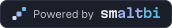
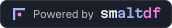
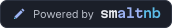
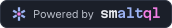
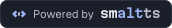

# "Powered by" badges

For sites and projects that use smaltdb, smaltui, smaltbi, smaltdf, smaltnb, smaltql or smaltts. Each badge is 172 × 28 px, with a light and a dark version, and its text converted to paths so it needs no fonts.

| Light | Dark |
| --- | --- |
|  |  |
|  |  |
|  |  |
|  |  |
|  |  |
|  |  |
|  |  |

Use the badge for the project you build on, and link it to that project:

| Badge | Link to |
| --- | --- |
| Powered by smaltdb | `https://smaltdb.dev` |
| Powered by smaltui | `https://github.com/stenhoor/smaltui` |
| Powered by smaltbi | `https://github.com/stenhoor/smaltbi` |
| Powered by smaltdf | `https://github.com/stenhoor/smaltdf` |
| Powered by smaltnb | `https://github.com/stenhoor/smaltnb` |
| Powered by smaltql | `https://github.com/stenhoor/smaltql` |
| Powered by smaltts | `https://smaltworks.dev/products/smaltts` |

## In a GitHub README or web page (follows light and dark mode)

```html
<a href="https://smaltdb.dev">
  <picture>
    <source media="(prefers-color-scheme: dark)" srcset="https://raw.githubusercontent.com/stenhoor/smalt-brand/main/badges/powered-by-smaltdb-on-dark.svg">
    
  </picture>
</a>
```

For smaltui, smaltbi, smaltdf, smaltnb, smaltql or smaltts, replace `smaltdb` in the three file names and the alt text, and use that project's link.

## Plain Markdown (light badge only)

```markdown
[](https://smaltdb.dev)
```

## On a production site

Copy the two SVG files into your site and point the snippet at your copies. Raw GitHub files work, but they aren't served from a CDN.

## "A smaltworks project"

| Light | Dark |
| --- | --- |
|  |  |

For smaltworks' own products: an endorsement under the product's own brand, in a footer or at the end of a README. It is not for third-party projects; they use the "Powered by" badges.

## Rules

- Show the badge at 28 px tall, or scale it evenly; keep at least 8 px of space around it.
- Don't recolour, crop or redraw it. If you need another size, scale the SVG.
- Use the dark version only on dark backgrounds, or let `<picture>` choose.

Regenerate with `python3 scripts/badges.py <Geist[wght].ttf> <MartianMono[wdth,wght].ttf>` (fonts from [google/fonts](https://github.com/google/fonts)).
