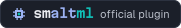
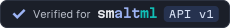

# Plugin badges

Three badges say how a plugin relates to its product: smaltdb, or smaltml (whose plugin API is its kernel contract, smaltml ADR 0035). They share the "Powered by" pill's size and type, and each tier drops one brand element.

| Light | Dark | Tier | Who grants it |
| --- | --- | --- | --- |
|  |  | **Official:** made and maintained by smaltworks | smaltworks |
|  |  | **Verified:** passes the smaltworks compatibility tests for plugin API version 1 | smaltworks, after the tests pass |
|  |  | **Works with:** the author says it works; smaltworks hasn't checked | The plugin's author |
|  |  | **Official,** for smaltml (smaltml-simd) | smaltworks |
|  |  | **Verified,** for smaltml's kernel contract version 1 | smaltworks, after the tests pass |
|  |  | **Works with,** for smaltml | The plugin's author |

## Which badge you may use

- **Official** is only for packages in the `@smaltworks` npm scope, which only smaltworks can publish to.
- **Verified** is only for plugins listed as verified on the product's plugin list (smaltdb.dev/plugins; smaltml's site's plugins page), for the API version on the badge. Link the badge to that entry. Verified means the compatibility tests pass; it is not a security review.
- **Works with** is open to any plugin author. Link it to your own project page.

Name a third-party plugin `<product>-plugin-<name>`, for example `smaltdb-plugin-geo`. The `@smaltworks` scope and names that start with `smalt` are reserved for smaltworks.

## Snippet

```html
<a href="https://github.com/you/smaltdb-plugin-geo">
  <picture>
    <source media="(prefers-color-scheme: dark)" srcset="https://raw.githubusercontent.com/stenhoor/smalt-brand/main/badges/plugins/works-with-smaltdb-on-dark.svg">
    
  </picture>
</a>
```

A Works with badge links to your own project page, as here. For Official or Verified, change the file names and alt text, and link to the plugin's entry on the product's plugin list (smaltdb.dev/plugins; smaltml's site's plugins page). The badges vary in width, so set only the height.

Regenerate with `python3 scripts/plugin_badges.py <Geist[wght].ttf> <MartianMono[wdth,wght].ttf>`. smaltdb and smaltml have plugin APIs today; when another product gets one, add it to `PRODUCTS` in the script.
